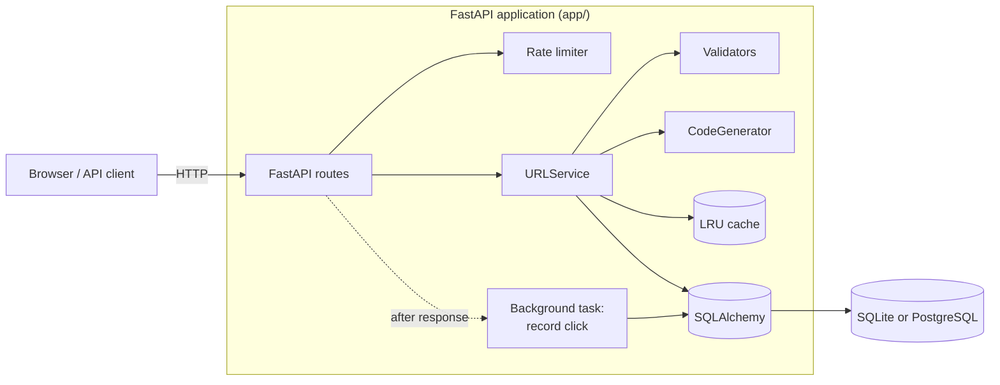
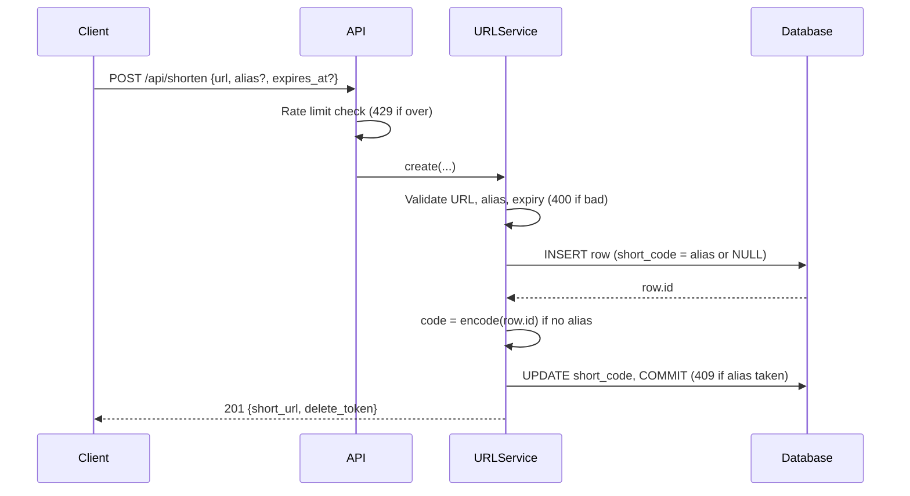
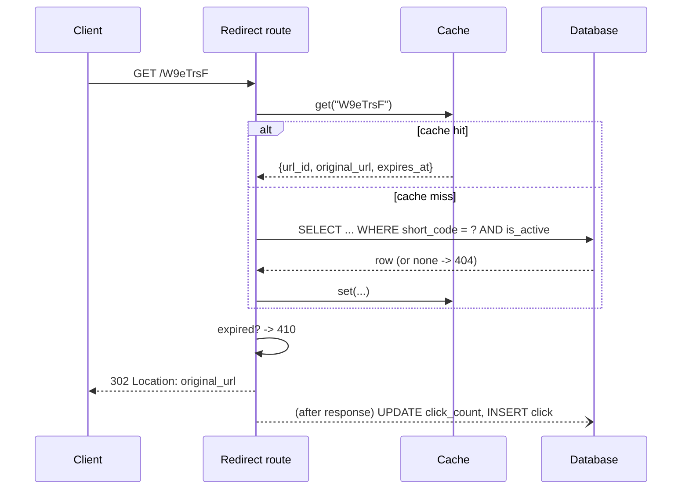
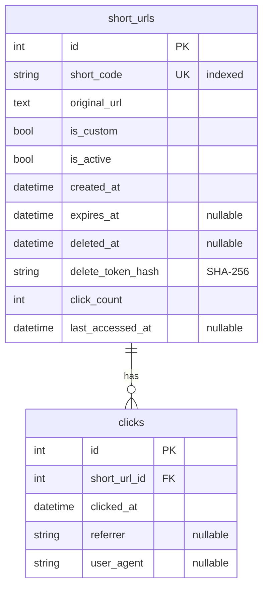

# Design Document: URL Shortener

| | |
|---|---|
| **Version** | 1.0.0 |
| **Date** | October 2026 |
| **Status** | Implemented |

This document explains how the URL shortener works and, above all, **why** it was built this way. Each major decision lists the options considered, the choice made, and the trade-offs accepted.

---

## Contents

1. [Overview](#1-overview)
2. [Requirements](#2-requirements)
3. [Architecture](#3-architecture)
4. [Technology choices](#4-technology-choices)
5. [Data model](#5-data-model)
6. [Short-code generation](#6-short-code-generation)
7. [Custom aliases and duplicate URLs](#7-custom-aliases-and-duplicate-urls)
8. [Redirect behaviour](#8-redirect-behaviour)
9. [Caching](#9-caching)
10. [Click analytics](#10-click-analytics)
11. [Expiry and deletion](#11-expiry-and-deletion)
12. [Security, validation and rate limiting](#12-security-validation-and-rate-limiting)
13. [Scaling path](#13-scaling-path)
14. [Testing strategy](#14-testing-strategy)
15. [Configuration and deployment](#15-configuration-and-deployment)
16. [Known limitations and future work](#16-known-limitations-and-future-work)
17. [Decision summary](#17-decision-summary)

---

## 1. Overview

Long URLs are hard to share: they break across lines, use up character limits, and look untrustworthy. This service maps a long URL to a short code and, when someone visits `BASE_URL/<code>`, redirects them to the original address.

The project aims to be:
- **Correct**: codes never collide, expired and deleted links behave predictably.
- **Fast on the hot path**: redirects are the most frequent operation and must stay cheap.
- **Simple to run**: one command locally, one container in production, no required external services.
- **Ready to grow**: every component that would limit scale sits behind a small interface that can be swapped (database, cache, rate limiter).

---

## 2. Requirements

### 2.1 Functional

| # | Requirement | Implemented by |
|---|---|---|
| F1 | Shorten a long URL into a unique short URL | `POST /api/shorten` |
| F2 | Redirect a short URL to the original | `GET /{code}` |
| F3 | Let users choose a custom alias | `custom_alias` field |
| F4 | Let links expire | `expires_at` field, `410 Gone` |
| F5 | Show click analytics | `GET /api/urls/{code}/stats` |
| F6 | Let the creator delete a link | `DELETE /api/urls/{code}` + delete token |
| F7 | Reject invalid or unsafe URLs | `validators.py` |
| F8 | Provide a simple UI | `app/static/index.html` |

### 2.2 Non-functional

| Requirement | Target | How it is met |
|---|---|---|
| Low redirect latency | A few milliseconds in-process | LRU cache, indexed lookups, click logging after the response |
| Read-heavy load | Around 100 redirects per link created | Cache sized for hot links; reads never wait on writes (SQLite WAL) |
| No collisions | Zero | Bijective code generation (section 6) |
| Non-guessable codes | Not trivially enumerable | Scrambled IDs (section 6) |
| Durability | No lost mappings | Relational DB with transactions; soft deletes |
| Abuse resistance | Bounded creation rate | Token-bucket rate limit (section 12) |
| Portability | Runs anywhere Python or Docker runs | SQLite default, Postgres optional |

---

## 3. Architecture

### 3.1 Components



The code is split into layers so each can be tested and replaced on its own:

| Layer | Files | Responsibility |
|---|---|---|
| HTTP | `routes/api.py`, `routes/redirect.py` | Parse requests, map domain errors to status codes |
| Domain | `services.py` | All business rules: create, resolve, stats, delete |
| Support | `encoding.py`, `validators.py`, `cache.py`, `rate_limit.py` | Pure, independently tested utilities |
| Persistence | `models.py`, `database.py` | Tables, engine, sessions |
| Wiring | `main.py`, `config.py` | Build the app from settings |

**Decision: application factory (`create_app(settings)`).** Every dependency (engine, cache, limiter, service) is created from a `Settings` object and attached to `app.state`. Tests build a fresh app with a temporary database per test, with no global state leaking between them. The alternative, module-level globals, is simpler but makes tests share state and makes the app hard to configure twice in one process.

### 3.2 Request flows

**Create a link**



**Follow a link (hot path)**



### 3.3 Route ordering

`GET /{code}` matches any single path segment, so it would swallow `/docs`, `/health` and so on if registered first. **Decision:** register it last in `main.py`, and reserve those words so no alias can take them (section 7).

---

## 4. Technology choices

### 4.1 Language and framework: Python + FastAPI

| Option | Pros | Cons |
|---|---|---|
| **FastAPI** ✅ | Type hints drive validation and OpenAPI docs; async-capable; very little boilerplate | Younger ecosystem than Django |
| Flask | Minimal and familiar | Validation and API docs need add-ons |
| Django | Batteries included (admin, ORM, auth) | Heavy for a small single-purpose service |
| Node.js / Express | Fast I/O | Less built-in validation; outside the chosen stack |
| Go | Excellent raw performance | More code for the same features; slower to iterate |

**Why FastAPI:** the API is small, and FastAPI turns Pydantic models into request validation, response serialisation and interactive docs (`/docs`) with no extra code. That makes the project easy to explore and demonstrate.

**Sync endpoints, on purpose.** Endpoints are regular `def` functions, which FastAPI runs in a thread pool. SQLAlchemy's synchronous API is the most mature, and the work per request is a single indexed query. Moving to async (`asyncpg`) is possible later but adds complexity without a measurable gain at this scale.

### 4.2 Database: SQLite by default, PostgreSQL in production, via SQLAlchemy 2.0

The data is essentially a key-value map (`code → URL`) plus click events.

| Option | Verdict |
|---|---|
| **SQLite** ✅ (default) | No server to install, a single file, ACID. WAL mode lets readers proceed while one writer commits. Ideal for development and small deployments |
| **PostgreSQL** ✅ (production) | Concurrent writers, replication, mature tooling. Selected by changing `DATABASE_URL` |
| NoSQL (DynamoDB, Cassandra) | Excellent for huge key-value workloads, but needs cloud or cluster setup, and the analytics queries (group by day, top referrers) are less natural |
| Redis as primary store | Very fast but memory-bound and weaker durability guarantees |

**Why SQLAlchemy:** one model definition works on both SQLite and PostgreSQL. All queries use portable constructs (`func.date`, `func.count`, `coalesce`), so switching databases needs no code change.

### 4.3 Other tools

| Tool | Purpose | Reason |
|---|---|---|
| Pydantic v2 | Schemas | Fast validation, clear errors, powers OpenAPI |
| pydantic-settings | Config | Typed settings from env vars and `.env`, validated at start-up |
| Uvicorn | ASGI server | Standard production server for FastAPI |
| pytest + TestClient | Tests | Exercise the real HTTP stack in-process, no server needed |
| Ruff | Lint/format | One fast tool replacing flake8, isort and black |
| Docker / Compose | Packaging | Identical runtime everywhere; optional Postgres profile |
| GitHub Actions | CI | Free for public repos; tests three Python versions |
| Vanilla HTML/JS | UI | No build step or framework for a single form |

---

## 5. Data model



Key decisions:

- **Integer primary key separate from `short_code`.** The ID drives code generation (section 6). Keeping the code in its own unique, indexed column means custom aliases and generated codes share one lookup path.
- **`short_code` is nullable**, but only for the instant between INSERT and UPDATE inside one transaction. The generated code depends on the ID, which the database assigns on INSERT. Unique indexes in both SQLite and PostgreSQL allow multiple NULLs, so this is safe.
- **`original_url` is `TEXT`**, not a fixed `VARCHAR`. Length is enforced in the application (`MAX_URL_LENGTH`), which is easier to change than a column type.
- **Denormalised `click_count`** on `short_urls`, alongside the detailed `clicks` table. The total is read often and is a single-row read; computing `COUNT(*)` over clicks every time would get slower as a link becomes popular. Detailed rows are kept for breakdowns.
- **Composite index `(short_url_id, clicked_at)`** on `clicks`, so per-link, per-time-range analytics stay index scans.
- **All timestamps in naive UTC.** SQLite has no timezone type. Storing everything as UTC and converting at the edges (`_to_naive_utc`) avoids mixed-zone bugs. The API documents that times are UTC.
- **`ON DELETE CASCADE`** on clicks, for when hard deletes or data retention jobs are added.

**Schema migrations.** Tables are created on start-up with `create_all`, which is enough for a first version. Once the schema starts evolving, Alembic should replace it (section 16).

---

## 6. Short-code generation

This is the core design problem.

### 6.1 Options considered

| Approach | Collisions | Predictable | Needs extra lookup | Notes |
|---|---|---|---|---|
| Base62 of the auto-increment ID | None | **Yes**: `1, 2, 3…` reveals volume and allows enumeration | No | Simplest |
| Hash the URL (MD5/SHA) and truncate | **Possible**, needs detection and retry | No | Yes, on every insert | Same URL always gives the same code, which conflicts with per-link analytics |
| Random code + uniqueness check | Possible, retry | No | Yes, on every insert | Retries grow as the space fills |
| Pre-generated key service | None | No | No | Needs a separate service and key storage |
| **Base62 of a *scrambled* ID** ✅ | **None** | **Not obviously** | **No** | One extra arithmetic step |

### 6.2 Chosen approach: bijective scrambling of the database ID

Let `N = 62^7` (the number of 7-character Base62 codes) and `M` a multiplier coprime with `N`:

```
x = (id · M + offset) mod N          # affine step
x = reverse the 7 Base62 digits of x # spreads the low digits to the front
x = (x  · M + offset) mod N          # affine step again
code = base62(x), left-padded to 7 characters
```

**Why it never collides.** Each step is a bijection on `[0, N)`:
- `x → (x·M + offset) mod N` is invertible because `gcd(M, N) = 1`, so `M` has a modular inverse.
- Reversing a fixed-width digit string is its own inverse.

A composition of bijections is a bijection, so **every ID maps to exactly one code and no two IDs share a code**. No uniqueness check or retry loop is needed. The test suite checks this exhaustively for a 3-character space (238,328 codes) and round-trips `decode(encode(id)) == id` for 7 characters.

**Why two rounds with a digit reversal.** One affine step alone leaves visible patterns. Adding `M` each time means the last digit cycles predictably and the leading digits change slowly, so consecutive codes look like neighbours. Reversing the digits between two rounds pushes the fast-changing low digits to the front before mixing again. The result: IDs 1–4 become `W9eTrsF`, `uxltIt3`, `tfgWosr`, `V9dVyRO`.

**Why it is coprime-checked.** `N = 62^7 = 2^7 · 31^7`, so `M` must be odd and not divisible by 31. `CodeGenerator` refuses to start otherwise, turning a silent collision bug into a start-up error.

**Honest limits.** This is obfuscation, not encryption. Anyone who knows the algorithm and collects enough codes could recover `M` and `offset`. It stops casual enumeration (`…/aaaaaab`, `…/aaaaaac`) and hides how many links exist, which is the goal. For links that must be **unguessable** (private documents), use random 128-bit tokens instead (section 16).

**Operational rule.** `ID_SCRAMBLE_MULTIPLIER`, `ID_SCRAMBLE_OFFSET` and `CODE_LENGTH` must be set once per deployment and never changed. If they change, new IDs could map onto codes already in use. The service detects this: a unique-constraint failure on a generated code raises a clear `RuntimeError` naming those settings, rather than being misreported.

### 6.3 Code length and capacity

| Length | Codes available | Lasts at 100 M links/month |
|---|---|---|
| 6 | 56.8 billion | ~47 years |
| **7** ✅ | **3.52 trillion** | **~2,900 years** |
| 8 | 218 trillion | effectively forever |

Seven characters gives effectively unlimited room while staying short. Codes are **fixed length** (left-padded), which keeps URLs uniform and lets the system tell generated codes apart from custom aliases (section 7).

### 6.4 Why Base62

Base62 (`0-9a-zA-Z`) is URL-safe without escaping. Base64 adds `+` and `/` (or `-` and `_`), which can be mangled or look odd in links. Base36 (lower-case only) would need more characters for the same capacity. The trade-off is that codes are case-sensitive, which is standard for shorteners.

---

## 7. Custom aliases and duplicate URLs

### 7.1 Alias rules

| Rule | Reason |
|---|---|
| 3–30 characters of `A-Z a-z 0-9 - _` | URL-safe, readable, no escaping |
| Not a reserved word (`api`, `docs`, `health`, `static`, `admin`, …) | Can never shadow an app route or a future one |
| **Not exactly 7 alphanumeric characters** | Keeps aliases out of the generated-code namespace |

**The namespace rule is the key decision.** Generated codes are always exactly 7 Base62 characters. If someone could reserve `abcdefg` as an alias, a future ID might encode to `abcdefg`, and the insert would fail. Rejecting aliases with the exact generated shape makes the two sets of codes disjoint by construction. Users can still pick `abc-efg`, `abcdef` or `abcdefgh`.

Alternatives considered: re-checking each generated code against aliases and skipping clashes (breaks the clean bijection and adds a lookup), or prefixing aliases (e.g. `/c/my-link`, which makes them longer and less friendly).

**Race conditions.** Two people requesting the same alias at once are handled by the database unique constraint, not by a check-then-insert. The loser's transaction gets an `IntegrityError`, which becomes `409 Conflict`.

### 7.2 Duplicate URLs: always create a new code

Shortening the same URL twice returns **two different codes**.

| Option | Pros | Cons |
|---|---|---|
| Return the existing code (deduplicate) | Saves a row | Analytics mix between unrelated people and campaigns; the second person would not get a delete token; extra lookup per insert |
| **Always create new** ✅ | Each link has its own owner, analytics and expiry | Slightly more rows |

Storage is cheap (about 500 bytes per row), while analytics that mix unrelated sources are misleading. This also matches how commercial shorteners treat separate campaigns.

---

## 8. Redirect behaviour

### 8.1 302 by default, configurable

| Status | Browser caches | Every click reaches the server | Use when |
|---|---|---|---|
| 301 Moved Permanently | Yes | **No**, so analytics undercount | Lowest load, no analytics needed |
| **302 Found** ✅ | No | **Yes** | Analytics matter (default) |
| 307 / 308 | As 302 / 301 | | Also preserve the HTTP method |

**Decision:** default to **302** with `Cache-Control: private, no-store`, because click analytics are a feature and a cached 301 would bypass the server entirely. Links can also be deleted or expire, which a browser-cached 301 would ignore. Deployments that care only about load can set `REDIRECT_STATUS_CODE=301`.

### 8.2 Error responses

| Situation | Status | Why |
|---|---|---|
| Code never existed or was deleted | **404 Not Found** | Standard "no such resource" |
| Link expired | **410 Gone** | Tells clients and crawlers the resource existed and is intentionally gone, so it should not be retried or indexed |

Redirect errors return a small **HTML page**, because the visitor is usually a person in a browser who followed a link. API errors (`/api/...`) return **JSON** `{"detail": "..."}` for programs.

---

## 9. Caching

### 9.1 Why cache

Link traffic follows a power law: a few links get most clicks. Caching `code → (url_id, original_url, expires_at)` serves those links from memory without a database query.

### 9.2 Design

- **LRU eviction** with a size cap (`CACHE_MAX_ITEMS`, default 10,000), so memory stays bounded and the hottest links stay in.
- **TTL** (`CACHE_TTL_SECONDS`, default 1 hour) as a safety net, so any staleness eventually heals.
- **Thread-safe** with a lock, because FastAPI runs sync endpoints in a thread pool.
- **Expiry is checked on every request, including cache hits.** The cached entry carries `expires_at`, so a cached link still returns 410 the moment it expires. (Tested.)
- **Explicit invalidation on delete**, so a deleted link stops redirecting immediately, not after the TTL.
- **Negative results are not cached.** Caching "not found" could briefly hide a just-created custom alias. Lookups for unknown codes are cheap index misses anyway.

### 9.3 Why in-process rather than Redis

An in-process cache needs no extra service and is the fastest possible lookup. Its limit: with **several app instances**, each has its own cache, and a delete on one instance does not clear the others (they heal within the TTL). The cache exposes `get / set / delete / clear`, so a Redis implementation can drop in when the app scales out (section 13).

---

## 10. Click analytics

### 10.1 Logging after the response

Clicks are recorded in a FastAPI `BackgroundTask`, which runs **after** the redirect has been sent. The visitor never waits for the analytics write. The task opens its own database session, since the request session is already closed by then.

**Trade-off:** if the process crashes between sending the redirect and writing the click, that click is lost. For analytics this is acceptable; the redirect itself is what matters. A higher-volume design would push events onto a queue such as Redis Streams or Kafka (section 13).

### 10.2 Atomic counter

The total is updated with `UPDATE short_urls SET click_count = click_count + 1`, which the database executes atomically. A read-modify-write in Python (`row.click_count += 1`) would lose updates when two clicks on the same link run at the same time.

### 10.3 What is stored, and what is not

Stored per click: time, `Referer` header (truncated to 512 characters), `User-Agent` (truncated). **Not stored: IP addresses.** IP addresses are personal data under laws such as GDPR and India's DPDP Act. The current analytics don't need them, so the safest choice is not to collect them. Country-level stats could later be derived at request time and stored as a country code only.

### 10.4 Stats endpoint

`/api/urls/{code}/stats` returns the total, last access, a **zero-filled** 7-day series (days with no clicks appear as 0, so charts don't need gap handling), and the top 5 referrers (with `direct` for none). Stats are **public by code**, like most shorteners. Anyone with the short link can already click it, and the stats reveal nothing beyond aggregate counts.

---

## 11. Expiry and deletion

### 11.1 Expiry

- Optional `expires_at` (ISO 8601). Times without a zone are read as UTC; zoned times are converted to UTC.
- Must be in the future and at most `MAX_EXPIRY_DAYS` (365) ahead, which catches typos like the year 2206.
- **Lazy expiry:** links are not deleted when they expire. Each request compares `expires_at` with the current time and returns 410. This needs no background job, is exact to the second, and keeps the row for analytics. A periodic cleanup job can be added later if storage matters.

### 11.2 Ownership without accounts: the delete token

Without user accounts, the service still needs to know who may delete a link.

| Option | Verdict |
|---|---|
| Anyone can delete | Unacceptable: anyone could break anyone's links |
| User accounts + login | Correct long-term, but a large scope increase (passwords, sessions, password reset) |
| **One-time delete token** ✅ | The creator gets a 192-bit random token at creation; presenting it in `X-Delete-Token` proves ownership |

Details:
- Generated with `secrets.token_urlsafe(24)` (cryptographically secure).
- **Only its SHA-256 hash is stored**, like a password. A database leak does not reveal tokens. A fast hash (rather than bcrypt) is fine here because the token is high-entropy random data, not a human-chosen password, so it can't be brute-forced.
- Compared with `hmac.compare_digest` (constant time), so response timing leaks nothing.
- Returned **once** and never again. The UI tells users to save it.

### 11.3 Soft delete, and codes are never reused

Deleting sets `is_active = false` and `deleted_at`. The row and its code stay. **Codes are never reused**, because a short link may still be printed on posters, saved in bookmarks or posted on websites. If a deleted code could be reassigned, those old links would silently send people to a stranger's destination, which is a phishing risk. Generated codes are tied to IDs (never reused), and custom aliases stay reserved after deletion (tested: re-creating a deleted alias returns 409).

---

## 12. Security, validation and rate limiting

### 12.1 URL validation

| Check | Threat prevented |
|---|---|
| Scheme must be `http` or `https` | `javascript:`, `data:`, `file:` URLs, which could run script or read local files |
| Host required and well formed (labels, no `..`, no spaces) | Garbage and malformed links |
| `localhost` and dotless hosts rejected | Pointless links to the visitor's own machine; intranet names |
| Own domain rejected | **Redirect loops** and chains that hide the real destination |
| Max 2048 characters | Oversized payloads; most browsers and servers cap around this |
| Valid port | Malformed URLs |
| Missing scheme becomes `https://` | Usability: people paste `example.com/page` |

**Not included (yet):** checking destinations against malware or phishing lists (e.g. Google Safe Browsing). It needs an external API key and network calls. It is the most important addition before running a public instance (section 16).

**SSRF note.** The server never *fetches* the destination URL; it only sends it back in a `Location` header. So the classic server-side request forgery risk does not apply. If link previews (fetching page titles) are added later, private IP ranges must be blocked at that point.

### 12.2 Other measures

- **Output escaping** in the UI: all server data is escaped before being inserted into HTML, so a malicious URL can't inject script.
- **Container runs as a non-root user.**
- **Parameterised queries** everywhere via SQLAlchemy, which prevents SQL injection.
- **Secrets stay out of git**: `.env` is ignored; `.env.example` documents settings with no secrets.

### 12.3 Rate limiting: token bucket per client IP

Only **link creation** is limited. It is the operation that grows the database and is the one abused by spam bots. Redirects are not limited, because they are the product.

| Algorithm | Behaviour | Verdict |
|---|---|---|
| Fixed window | Allows 2× the limit across a window boundary | Rejected |
| Sliding log | Exact, but stores every timestamp | More memory than needed |
| **Token bucket** ✅ | Allows a burst up to the limit, then a steady refill | Matches real use: paste a few links at once, then pause |

Each client gets `RATE_LIMIT_PER_MINUTE` tokens (default 30) refilling evenly. Over-limit requests get **429** with a `Retry-After` header saying how many seconds to wait. Buckets that have fully refilled are swept away periodically, so memory doesn't grow with every IP ever seen.

**Client IP behind proxies.** By default the limiter uses the socket's peer address. `X-Forwarded-For` is honoured only when `TRUST_PROXY_HEADERS=true`, because any client can forge that header; trusting it without a proxy in front would let attackers bypass the limit.

Like the cache, the limiter is in-process. With several instances, each enforces its own limit, so a Redis-backed limiter is the scale-out path.

---

## 13. Scaling path

The current design comfortably serves a single instance. Back-of-envelope figures for a large deployment, assuming 100 M new links per month and 100 reads per write:

| Metric | Estimate |
|---|---|
| Writes | ~40 / second (100 M ÷ 2.6 M seconds) |
| Reads (redirects) | ~4,000 / second |
| Storage, 5 years | 6 B links × ~500 B ≈ **3 TB** (plus click events) |
| Cache for hot links | ~20% of daily distinct links × ~500 B → a few tens of GB |

How each component scales, without redesigning the core:

| Step | Change | Why it's easy |
|---|---|---|
| 1 | Move to **PostgreSQL** | One setting (`DATABASE_URL`); queries are portable |
| 2 | Run **several app instances** behind a load balancer | The app holds no state that needs sharing except cache and limiter |
| 3 | Swap cache and limiter to **Redis** | Both sit behind small interfaces (`get/set/delete`, `acquire`) |
| 4 | Add **read replicas** for redirects | Redirects are read-only queries |
| 5 | Send click events to a **queue** (Kafka / Redis Streams) and batch-insert | Background task already decouples clicks from redirects |
| 6 | Move click data to an analytics store (ClickHouse, TimescaleDB) | Clicks are append-only time series |
| 7 | **Shard** `short_urls` by code | Lookups are always by exact code, a natural shard key |
| 8 | Put a **CDN / edge** in front, with 301 for links that don't need analytics | Removes most traffic from the origin |

**ID generation across shards.** The scrambling only needs a unique integer per link. With one database, the auto-increment ID provides it. With several, use block allocation (each instance reserves a range of IDs) or a Snowflake-style ID generator. Codes stay collision-free as long as IDs are unique.

---

## 14. Testing strategy

51 automated tests, run in about 2 seconds, in four groups:

| Suite | What it proves |
|---|---|
| `test_encoding.py` | Base62 round-trips; **exhaustive bijection** over a full 3-character space; 7-character round-trips; consecutive IDs don't give similar codes; bad multipliers are rejected |
| `test_api.py` | Every endpoint and status code through the real HTTP stack: creation, validation errors, aliases, conflicts, reserved words, namespace rule, 302/301, 404/410, expiry via cache, click counting and referrers, delete with right/wrong/missing token, alias not reusable, rate limiting, health, docs |
| `test_cache_and_limiter.py` | LRU order, TTL expiry (with a fake clock), disabled cache, hit/miss counters, token refill timing, per-client isolation |
| `test_config.py` | Hosting-provider database URLs switch to the right driver; Render's public URL is picked up; blank variables fall back to defaults; invalid settings are rejected |

**Isolation.** Each test builds its own app with a fresh temporary SQLite file through the app factory. No test depends on another's data, and the suite can run in any order.

**Time.** Time-dependent behaviour (TTL, refill, expiry) is tested by patching the clock or editing stored timestamps, rather than sleeping, so the suite stays fast and deterministic.

**Two databases, one suite.** By default tests use SQLite. Setting `TEST_DATABASE_URL` runs the identical suite against PostgreSQL, which is what production uses. This catches SQL that works on one database but not the other (for example, the date grouping in the analytics query).

**CI.** GitHub Actions runs Ruff and pytest on Python 3.11, 3.12 and 3.13, runs the suite again against a PostgreSQL 16 service container, then builds the Docker image, starts it, and waits for `/health` to answer.

---

## 15. Configuration and deployment

- **Twelve-factor config.** Every setting comes from environment variables (or `.env`) via `pydantic-settings`, validated at start-up. Invalid values (e.g. `REDIRECT_STATUS_CODE=200`, a non-coprime multiplier) stop the app immediately with a clear error, rather than failing later.
- **Docker image**: `python:3.12-slim`, dependencies installed in a cached layer before the code is copied, non-root user, built-in `HEALTHCHECK` against `/health`.
- **Compose** runs the app with SQLite on a named volume by default; `--profile postgres` adds PostgreSQL 16.
- **`/health`** checks database connectivity, so load balancers and orchestrators can route around an unhealthy instance.
- **Port from the environment.** The container listens on `$PORT` (default 8000), because platforms such as Render, Railway and Cloud Run assign the port.
- **Hosting-provider URLs accepted as-is.** Providers hand out `postgres://` or `postgresql://` connection strings. SQLAlchemy reads the first as unknown and, in version 2.0, maps the second to the `psycopg2` driver, which is not installed. The settings layer rewrites both to `postgresql+psycopg://` (psycopg 3), so users paste the string they were given.
- **Blank variables mean "default".** Setup forms often create a variable with an empty value. Treating blanks as unset avoids start-up crashes such as an empty `ID_SCRAMBLE_OFFSET` failing integer parsing.
- **Production checklist**: set `BASE_URL` to the public domain; choose your own `ID_SCRAMBLE_*` values; use PostgreSQL; run behind HTTPS (a reverse proxy such as Nginx or Caddy) and set `TRUST_PROXY_HEADERS=true` there; run several Uvicorn workers (`--workers N`).

---

### 15.1 Hosting decision: Render

| Option | Pros | Cons |
|---|---|---|
| **Render** ✅ | Deploys from GitHub on every push; native Docker; managed Postgres; a Blueprint file (`render.yaml`) describes the whole setup; free tier with HTTPS | Free services sleep after 15 minutes idle (about 1 minute to wake); free Postgres expires after 30 days |
| Railway | Very simple, good Postgres | Usage-based billing after trial credit |
| Fly.io | Runs close to users, persistent volumes | More CLI setup; billing details required |
| Google Cloud Run | Scales to zero, generous free requests | Needs a separate database and more cloud configuration |
| A VPS (e.g. a small cloud VM) | Full control, `docker compose up` | You maintain the OS, HTTPS certificates and backups |
| Vercel / Netlify | Excellent for front-ends | Serverless functions don't fit a long-running app with an in-process cache and a database connection pool |

**Why Render:** it matches the project's existing shape (one Dockerfile, a `/health` endpoint, settings from environment variables) with no code changes, and `render.yaml` makes deployment reproducible from the repository itself, so anyone can deploy their own copy. The Blueprint selects the Singapore region, the closest Render region to India, for both the app and the database, so each query avoids a cross-continent round trip.

**Database on Render.** The disk of a free Render service is wiped on every restart, so SQLite would lose all links. The Blueprint therefore provisions Postgres. Because Render's free Postgres expires, the README documents swapping in Neon's free, non-expiring Postgres by changing only `DATABASE_URL`, which the design already supports.

**Client IP behind Render's proxy.** Requests reach the app through Render's load balancer, so the socket address is the proxy's, not the visitor's. The Blueprint sets `TRUST_PROXY_HEADERS=true`, so the rate limiter reads the visitor's address from `X-Forwarded-For`. The limiter takes the left-most address in that header; a client can prepend a fake one, so the limit is a deterrent rather than a hard guarantee. A deployment that needs strict limits should read the address the proxy itself appends (the right-most entry it adds) or enforce limits at the edge.

**Cold starts and the cache.** When a sleeping free service wakes, the in-process cache starts empty. The first redirects after a wake-up go to the database until the cache warms, which is correct but slightly slower. A paid always-on instance avoids this.

---

## 16. Known limitations and future work

| Limitation | Impact | Planned fix |
|---|---|---|
| No user accounts | Users can't list their links; losing the delete token means losing control | Accounts with API keys; link ownership by user |
| No malicious-URL screening | A public instance could be used for phishing | Google Safe Browsing / URLhaus check on create, plus periodic re-checks |
| In-process cache and limiter | Per-instance only when scaled out | Redis implementations of both interfaces |
| `create_all` instead of migrations | Schema changes need manual work | Alembic |
| Codes are obfuscated, not secret | Not suitable for private links | Optional "private link" mode using 128-bit random codes |
| Click logging can drop events on a crash | Small analytics gaps | Durable event queue |
| No QR codes, geo or device stats | Fewer features than commercial tools | QR endpoint; country from IP (stored as country only); parsed user agent |
| No link editing | Destination can't be changed | `PATCH` endpoint with token; cache invalidation |

---

## 17. Decision summary

| Area | Decision | Main reason |
|---|---|---|
| Framework | FastAPI | Validation and API docs from type hints |
| Database | SQLite default, PostgreSQL via config | Zero setup locally, robust in production, one codebase |
| Code generation | Base62 of a bijectively scrambled ID | No collisions, no retries, not sequential |
| Code length | 7 characters (3.5 trillion codes) | Short, effectively never runs out |
| Alias namespace | Aliases can't be 7 alphanumerics | Generated codes and aliases can never clash |
| Duplicate URLs | Always a new code | Separate analytics and ownership per link |
| Redirect | 302 + `no-store` (301 optional) | Every click counted; deletes and expiry take effect |
| Errors | 404 missing, 410 expired; HTML for browsers, JSON for API | Correct semantics for people and crawlers |
| Cache | In-process LRU + TTL, invalidated on delete | Hot links skip the DB; swappable for Redis |
| Analytics | Background task, atomic counter, no IPs stored | Fast redirects, correct counts, privacy |
| Ownership | One-time delete token, stored hashed | Ownership without building accounts |
| Deletion | Soft delete; codes never reused | Old printed links can't be hijacked |
| Rate limit | Token bucket per IP on creation only | Allows bursts, blocks floods, never slows redirects |
| Validation | http/https only, host checks, no self-links | Blocks script URLs, junk and redirect loops |
| Config | Env vars, validated at start-up | Fails fast; same image in every environment |
| Testing | Isolated app per test, fake clocks; SQLite and PostgreSQL | Fast, deterministic, order-independent, matches production |
| Hosting | Render Blueprint, Singapore region, Postgres | Deploy from GitHub with one file; persistent data; low latency from India |
